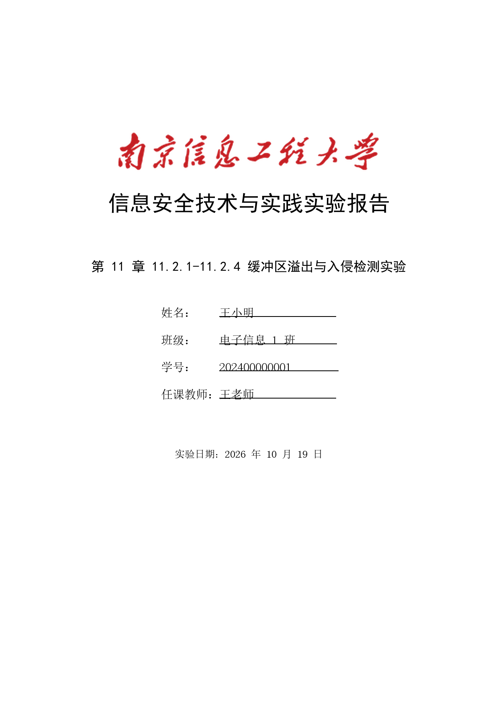

# ReportWriter

**南信大理工科实验报告写作器**

需搭配skill nuist-stem-lab-report使用：

[Yutai233/NUIST-stem-lab-report-skill: 这是一个面向南信大（NUIST）理工科课程实验报告自动化生成Skill，可根据用户提供的材料自动生成实验报告。](https://github.com/Yutai233/NUIST-stem-lab-report-skill)

正文由 DSH 加载 skill **`nuist-stem-lab-report`** 按课程资源写作，软件本身不编造任何实验数据。

📺 **使用教程**：[南京信息工程大学 ReportWriter 使用说明与介绍（Bilibili）](https://www.bilibili.com/video/BV1iunA6xEeM/)


封面上那行红色毛体校名，是软件按 `config.json` 里的素材图渲染的，颜色和字体都能在界面上换：



**它能做什么**

- 三步走：填封面 → 拖材料→ 启动程序
- 封面自动生成，并保存本地填写历史：下次可从下拉框选择之前的课程/实验/姓名/班级/学号/教师/日期
- 历史填写只保存在本机 `%LOCALAPPDATA%\ReportWriter\cover_history.json`，可一键清除
- 材料自动入库：DOCX 抽文字 + 抽内嵌图、PDF 抽文字（pypdf）、Markdown 还会**顺着本地图片路径把截图一起收进来**
- 支持直接 Ctrl+V 粘贴截图/文字/文件；也可以输入实验内容文件夹路径，递归导入图片、PDF、DOCX、文本
- 老师另外发了报告模板时可单独上传：DSH 会优先按模板的章节、表格和版式写，封面仍使用软件生成的页面
- 运行中和完成后显示本次 token 用量：输入、输出、缓存读/写和总计
- 支持暂停/继续：需要用户操作或补充材料时，可以暂停；补充后继续同一个 DSH 会话完成报告
- 运行结束后自动清理本次 `dsh headless` 会话，避免 DSH 侧栏越积越多“未分组”；可在 `config.json` 关闭
- 每次启动在后台检查 `nuist-stem-lab-report` skill 是否有更新，有更新时在页面顶部提示；不阻塞启动，也不自动覆盖本地 skill
- 报告由真正的 DSH agent 写：它自己加载 skill、读材料、选课程资源、画图插表，写不动会如实写进 `制作说明.md`
- 结束后软件自己调本机 Word 把 DOCX 转成 PDF，然后亮出「打开报告 / 打开 PDF / 打开目录」
- 历史任务可回放：表单、材料清单、完整日志、产物都在，随时能接着改；不要了可以一键删除（连文件夹一起删）
- 一键卸载：`一键卸载.exe` 会停程序、删快捷方式和程序文件，并询问是否一起删除历史任务；不动 DSH、skill、Python、Word

**环境要求**（缺一不可）

| 依赖                                    | 说明                                           |
| ------------------------------------- | -------------------------------------------- |
| Windows 10/11                         | 用到 Edge 应用窗口、Word COM、PowerShell             |
| [DSH](https://github.com/deepseek-ai) | 提供 `dsh` 命令；需已登录 DeepSeek Harness 账号或配置 `DEEPSEEK_API_KEY` |
| skill `nuist-stem-lab-report`         | 提供报告结构、课程资源、模板                               |
| Python                                | 用 DSH 自带的 runtime 即可（含 python-docx / Pillow） |
| pypdf                                 | 已内置在 `vendor\`，无需联网安装；删掉后安装脚本才会尝试补装 |
| Microsoft Word（可选）                    | 只有「同时导出 PDF」需要；没装也能交付 DOCX                   |

### DSH 鉴权（必须）

ReportWriter 本身不保存 API Key，写报告时由 DSH 负责鉴权。二选一：

1. **推荐：登录 DeepSeek Harness 桌面端**。登录一次后，ReportWriter 会自动检测账号凭据，并用一个临时
   `--patch` 让 `dsh headless` 使用账号路由，不需要 API Key。补丁也会显式启用 `credentials`、
   `authorization`、`deepseek-account` 三个插件，兼容默认没有启用它们的 headless profile。
   如果你自己在 `~/.dsh/profiles/headless/cordis.patch.yml` 里配置了模型路由，ReportWriter 不会覆盖它，
   只额外启用这三个鉴权插件（所以自定义的 `deepseek-account` 路由也能正常拿凭据）。
2. **或者配置 API Key**：在启动 ReportWriter 之前设置环境变量 `DEEPSEEK_API_KEY`；
   也可以直接在界面「开始」区的 **DSH API Key** 栏临时填写（只传给本次 DSH 进程，不写入磁盘或日志）。

两个都没配置时，运行日志会出现：

```text
llm-deepseek: no API key for provider route "deepseek-official"
```

这不是 ReportWriter 的故障，而是 DSH 没有可用的登录凭据。

## 0. 安装

### 方式一：一键安装（推荐）

把仓库下载/解压到任意目录（路径里有中文也没问题），双击 **`一键安装.exe`**
（带 ReportWriter 图标）。它会：

1. 找到可用的 Python 3（优先用 DSH 自带的那个），校验 `python-docx` / `Pillow`
2. 找到 `dsh.cmd`（找不到会让你粘贴路径）和 `nuist-stem-lab-report` skill
3. 检查 `vendor\` 里的 `pypdf`（已内置，通常直接通过；缺失时才尝试联网补装）
4. **选择工作区**：任务、材料和报告存放的根目录，默认 `%LOCALAPPDATA%\ReportWriter\tasks`，
   安装时可以直接输入其他路径；已有历史任务不会自动迁移
5. 按检测结果重写 `config.json`（`python` / `dsh` / `skill_root` 都写成可移植形式）
6. **自检**：现场生成一张 A4 封面预览 + 一份封面 DOCX，确认能跑
7. 在桌面建一个 `ReportWriter` 快捷方式

全程不写注册表、不改系统 PATH、不需要管理员权限。有提醒会以 `!` 开头逐条列出（比如没找到 dsh 时，
封面和材料整理照常可用，只是「开始写报告」会失败）。装完可以直接回车启动。

> 工作区推荐 **C: 盘上的纯英文路径**。选 D: 盘也可以：安装器会给当前用户补工作区的
> FullControl（DSH 沙箱需要 `WRITE_DAC/WRITE_OWNER`），补权限失败时会提示换路径或管理员修复。

> `一键安装.exe`、`ReportWriter.exe`、`一键卸载.exe` 都只是约 34 KB 的启动器，分别调用
> `install.ps1` / `app.py` / `uninstall.ps1`；源码在 `tools/`。它们没有代码签名，首次从网上下载运行时
> Windows SmartScreen 可能提示“未知发布者”，点「更多信息 → 仍要运行」即可。

### 方式二：手动

```powershell
git clone <本仓库地址> ReportWriter
cd ReportWriter
# pypdf 已经内置在 vendor\，不需要再安装。
# 只有在你手动删掉了 vendor\ 时，才需要补装：
# & "$env:USERPROFILE\.dsh\dsh-runtimes\dsh-primary-runtime\dependencies\python\python.exe" -m pip install -r requirements.txt --target vendor
```

然后改 `config.json` 里的 `dsh`（你的 dsh.cmd 路径）与 `skill_root`（skill 目录），两个都支持 `%ENV%`、`~` 和相对路径。

## 1. 启动

双击 **`ReportWriter.exe`**（带 ReportWriter 图标）即可。
它会用后台 Python 起一个本机服务，并弹出一个独立的 Edge 应用窗口

- 默认地址：<http://127.0.0.1:8791/>（端口被占用会自动往后顺延）

- 关掉窗口不会停服务；要退干净请点右上角 **退出**，或杀掉 python 进程

命令行启动（调试用）：

```powershell
& "$env:USERPROFILE\.dsh\dsh-runtimes\dsh-primary-runtime\dependencies\python\python.exe" app.py
```

## 2. 三步用法

### ① 封面信息

填 **实验课名称、实验名称、姓名、班级、学号、任课教师**（实验日期默认今天，可改）。
右边实时预览 A4 封面；点 **生成封面**，软件会在 `tasks\<任务>\封面.docx` 里生成真正的封面页，并在封面之后插入**分节符**，正文一定从第 2 页开始。

封面从上到下：**红色毛体「南京信息工程大学」校名**（11 cm 宽图片）→ 报告标题（26pt 黑体加粗）→
实验名称（16pt 黑体）→ 姓名 / 班级 / 学号 / 任课教师（14pt 宋体，**标签左对齐成一列、值带下划线、四行下划线等长且右端对齐**）→ 实验日期（12pt 宋体）。

校名默认是**图片素材** `assets\校名.png`：毛体没有可自由分发的字体文件，所以是从学校官方校名标识里裁出字形、
去掉校徽、染成 `#C41E23` 红再放大 3 倍。封面信息第一行的 **封面校名** 可以现场改三样：

| 控件   | 说明                                                                  |
| ---- | ------------------------------------------------------------------- |
| 校名文字 | 留空＝用 `config.json` 的 `school_text`；填了就换成你的学校（配合下面的字体用）              |
| 字体   | `毛体（图片）`＝用素材图；其余是系统字体（华文行楷 / 楷体 / 仿宋 / 黑体 / 宋体 / 微软雅黑 / 华文新魏），按文字排版 |
| 颜色   | 色板里选；毛体素材会按你选的颜色**重新上色**，文字版直接设字体颜色                                 |

改宽度调 `config.json` 的 `school_logo_cm`，换图直接替换 `assets\校名.png`（透明底 PNG，保持宽高比）；
把 `school_logo` 设成空字符串、字体留「毛体」时会退化为华文行楷 24pt 的文字兜底。

标题规则：课程名以「实验」结尾就补「报告」，否则补「实验报告」
（例：`信息安全技术与实践` → `信息安全技术与实践实验报告`）。

**历史填写记录**：每成功生成一次封面，软件会把课程、实验名称、姓名、班级、学号、教师、日期和
校名样式保存到本机 `%LOCALAPPDATA%\ReportWriter\cover_history.json`。下次在封面卡片顶部的
「历史填写」下拉框里选择即可自动填入；旁边的「清除记录」会删除全部历史。

### ② 实验材料

把老师给的东西直接拖进虚线框，或点它选文件：

| 支持                    | 处理方式                          |
| --------------------- | ----------------------------- |
| PDF                   | pypdf 抽文字；页数、无文字层（扫描件）会提示     |
| DOCX                  | python-docx 抽文字 + 抽出内嵌图片      |
| DOC（旧格式）              | 先用本机 Word 另存为 DOCX 再处理        |
| Markdown / TXT / HTML | 抽文字，**并自动跟随文内引用的本地图片**（截图不会丢） |
| PNG / JPG / BMP / GIF | 直接作为截图                        |
| 一段纯文字                 | 粘进下面的文本框，等同材料                 |

也可以：

- 在页面任意位置 **Ctrl+V** 粘贴截图或浏览器能提供的剪贴板文件
- 在「实验内容文件夹路径」里填本地文件夹（例如 `D:\实验二\材料`），点「读取文件夹」；
  会递归读取其中的图片、PDF、DOC/DOCX、Markdown/TXT/HTML 等文本
- 直接从 Explorer 复制文档文件本身时，浏览器通常拿不到文件路径；这种情况请拖入文件或使用文件夹路径

每份材料都会：复制进 `材料/`、抽文本到 `材料/抽取文本/`、图片进 `材料/附件图/`、写进 `材料/材料清单.md`。

**教师模板（可选）**：如果任课老师另外发了实验报告模板，在材料区的「实验报告模板」里上传
DOCX / DOC / DOTX / PDF。软件会把它复制进任务目录并生成大纲；DSH 会优先遵循模板的章节顺序、
表格字段和版式，程序内置的课程模板退居其次。封面仍使用软件生成的第 1 页，模板自带的封面不会被复制；
模板里的示例数据也不会被当作本次实验的实测数据。

### ③ 开始

选课程资源（默认「自动识别」，按课程名 + 实验名匹配），点 **🚀 开始写报告**。

「输出文件名」可以留空：留空时由模型自己起名（通常就是 `实验报告.docx`）；填了就用你给的
名字（不用写 `.docx`，路径符 `\ / : * ? " < > |` 会被自动换掉），提示词里会把它写成硬要求，
交付后软件也按这个名字找文件转 PDF。

「DSH 执行权限」默认是 **标准**（`workspace-write`，只允许写任务目录）。如果实验要求直接运行
MATLAB、Octave 等外部程序，选择 **完全访问**；运行前会再确认一次。完全访问会关闭 DSH 的命令沙箱
和审批，模型可以执行任意本机命令，**仅在你信任当前任务时使用**。

**暂停 / 继续**：运行中如果实验需要你手动操作、补充截图或继续提交材料，可以点 **暂停**；
DSH 模型自己发现缺材料时也会输出 `PAUSE: <原因>` 自动暂停。暂停后可以继续拖入材料、粘贴截图或
读取文件夹，然后点 **继续写报告**。软件会用原来的 `--session-id` 继续同一个 DSH 会话，不会从头重写；
暂停期间不会自动清理该会话，完成、结束或删除任务后才清理。手动暂停会中断当前正在执行的步骤，
DSH 会从已保存的会话上下文继续，必要时自动重试被中断的工具调用；模型自己请求的 `PAUSE` 会先自然结束本轮再暂停。

软件会：

1. 生成 `任务说明.md`（含封面、材料清单绝对路径、课程资源、输出要求、真实性约束）；
2. `dsh headless -` 启动一个全新 DSH 会话，把提示词从 stdin 喂进去，cwd 就是任务目录；
3. 实时把 DSH 的 stdout/stderr 打到页面上的黑色日志框；
4. 结束后扫描 `输出/*.docx`，识别最后一行 `DONE: <路径>`，**再由软件自己用本机 Word 把 DOCX 转成 PDF**
   （勾选了「同时导出 PDF」才转；约 10 秒）；
5. 运行区和页面顶部会显示进度条：写作阶段按时间估算，**只有报告文件真正落盘、任务完成后才显示 100%**；
   进度下方实时显示本次 DSH 的 token 用量（输入/输出/缓存读/写/总计）；
6. 亮出 **打开报告 / 打开 PDF / 输出目录** 按钮，记 `运行记录.log`，随时可以点 **中止**。

## 3. 目录结构

任务目录默认放在 **`%LOCALAPPDATA%\ReportWriter\tasks\`**（即 `C:\Users\<你>\AppData\Local\ReportWriter\tasks`），
不放在本工程目录下。DSH 的沙箱需要给工作区追加 ACL，当前用户必须对该目录有 `WRITE_DAC/WRITE_OWNER`；
否则会报 `SetNamedSecurityInfoW failed (Win32 5): grantWrite(...)`。

安装时可以把工作区改到其他目录（包括 D: 盘）。安装器会尝试给当前用户补工作区的 FullControl；
补权限失败时会提示换一个目录，或需要以管理员身份修复。手工修改 `work_root` 时也要确保该目录有完全控制权。

## 4. config.json

| 键                | 说明                                                                       |
| ---------------- | ------------------------------------------------------------------------ |
| `dsh`            | dsh 可执行文件，默认 `D:\dsh\resources\runtime\cli\bin\dsh.cmd`                  |
| `python`         | 打包 Python（python-docx / Pillow / pypdf 装在 `vendor`），默认指向 DSH 自带的 runtime |
| `vendor`         | 额外依赖目录，启动时挂到 `sys.path`（相对路径按本程序目录解析）                                    |
| `skill_root`     | `nuist-stem-lab-report` skill 目录，支持 `~` 与环境变量                            |
| `work_root`      | 任务/材料/报告根目录；安装时可选择，默认 `%LOCALAPPDATA%\ReportWriter\tasks`                     |
| `timeout`        | 单次写作最长秒数（默认 2700 = 45 分钟，超时自动 taskkill）                                  |
| `dsh_permission_mode` | DSH 默认权限：`workspace-write`（安全）或 `danger-full-access`（允许外部程序，风险高）        |
| `cleanup_dsh_session` | 运行后是否删除本次 headless 会话（默认 `true`，避免 DSH 侧栏出现“未分组”）                    |
| `skill_update_check` | 启动时是否检查 skill 仓库更新（默认 `true`；只提示，不自动覆盖本地 skill）                        |
| `port`           | 首选端口                                                                     |
| `open_browser`   | 启动后是否自动弹 Edge 应用窗口                                                       |
| `school_logo`    | 封面红字校名素材路径，默认 `assets/校名.png`；设空字符串则用文字兜底                                |
| `school_logo_cm` | 校名图片宽度（cm），默认 `11.0`                                                     |
| `school_text`    | 校名默认文字，默认 `南京信息工程大学`（界面「封面校名」留空时用它）                                      |
| `school_font`    | 校名默认字体，默认 `毛体`（＝图片素材）；可填 华文行楷/楷体/仿宋/黑体/宋体/微软雅黑/华文新魏                      |
| `school_color`   | 校名默认颜色，默认 `#C41E23`（界面上的色板会覆盖它）                                          |

## 5. 常见问题

**「图片/PDF 抽不出字」** → 扫描件没有文字层，软件会提示；直接把截图当图片丢进来即可，DSH 能看图。

**「pypdf 安装不上」** → 完整仓库已经把 `pypdf` 内置在 `vendor\`，安装过程不需要联网或 pip。如果仍然报错，
先确认解压时没有漏掉 `vendor\` 目录；再确认所用 Python 是 3.9 及以上（DSH 自带的 runtime 默认就满足）。

**「运行日志显示 no API key / 无 API Key」** → DSH 没有鉴权。打开 DeepSeek Harness 登录账号后重试
（ReportWriter 会自动使用账号路由），或者在启动 ReportWriter 前设置 `DEEPSEEK_API_KEY`，
也可以直接在界面「开始」区的 **DSH API Key** 栏临时填写。
装好后可以重新运行 `一键安装.exe`，它会检查并提示当前鉴权状态。

**「运行日志显示 ACCOUNT_SIGN_IN_REQUIRED」** → 账号路由已经生效，但 DSH 没有可用的正式账号 token
（常见于未完成登录、token 是 mock/开发凭据，或凭据来自本机开发环境）。在 DeepSeek Harness 里
**退出登录后重新登录**，再重开 ReportWriter；也可以直接在界面里填 `DEEPSEEK_API_KEY`。
新版 ReportWriter 会自动识别 mock/失效凭据并在界面上提示，不会再把它们当成“已登录”。

**「MATLAB 启动失败 / File system inconsistency / Exit Status 0x00000001」** → 这是 DSH 默认
`workspace-write` 沙箱拦住了 MATLAB 对安装目录、许可证或 AppData 的访问，不是 MATLAB 安装坏了。
在「开始」区把 **DSH 执行权限** 改为 **完全访问** 后重试（会二次确认，沙箱和命令审批会关闭）。
如果不想放宽沙箱，也可以在 ReportWriter 外手动运行 MATLAB，把真实截图/结果作为材料上传再生成。

**「导出 PDF」失败** → 需要本机装 Microsoft Word（软件用 COM 转换，Word 必须在沙箱外的软件进程里跑）。没装也能交付 DOCX。

**「导出 PDF 很慢 / 卡住」** → Word COM 需要单独启动 Word、加载插件、重排版面和图片，首次启动往往比后续慢。
本机若装了有道等 Word 插件（`YdWordAddIn` / `YoudaoGetWord64.Connect`），或后台残留了无窗口的
`WINWORD.EXE`，会明显拖慢甚至卡住。可先完全关闭 Word，取消/卸载有道 Word 插件后重试；
任务管理器里有残留 `WINWORD.EXE` 时结束它（确认没有未保存的 Word 文档）。新版导出脚本已关闭
隐藏对话框、拼写/语法检查和链接更新，并记录实际耗时；超时上限为 180 秒。

**「DSH 侧栏多出未分组的会话」** → 每次 ReportWriter 运行都会启动一个独立的 `dsh headless` 会话，
它会出现在 DSH 的会话列表里。新版默认在运行结束后自动删除本次会话；旧版本留下的可以
在 DSH 里手动隐藏/删除。若想保留这些会话用于排查，把 `config.json` 的
`cleanup_dsh_session` 设为 `false`。

**「D: 盘报 grantWrite / Win32 5」** → 当前用户对工作区缺少 `WRITE_DAC/WRITE_OWNER`。
重跑 `一键安装.exe` 并选择该工作区，安装器会自动补 ACL；也可以手动执行：

```powershell
icacls "D:\你的工作区\tasks" /grant "$($env:USERNAME):(OI)(CI)F" /T
```

**「dsh 启动失败 / 秒退」** → 看日志框和 `运行记录.log`；检查 `config.json` 里的 `dsh` 路径，命令行手动跑一次
`& 'D:\dsh\resources\runtime\cli\bin\dsh.cmd' headless -` 验证。

**封面字体不对** → 需要 黑体(simhei)、宋体(simsun)；Windows 一般自带。

**任务太多** → 打开「历史任务」，每行右边的 **删除** 按钮会把任务连同它的整个文件夹（材料 / 封面 / 输出）一起删掉，
删前有一次确认；也可以直接删 `%LOCALAPPDATA%\ReportWriter\tasks\` 里对应的目录。

## 6. 卸载

双击程序目录里的 **`一键卸载.exe`**。它会：

- 停止正在运行的 ReportWriter
- 删除桌面的 `ReportWriter` 快捷方式
- 删除程序文件（`一键卸载.exe` 自己最后也会清掉）
- 询问是否同时删除 `%LOCALAPPDATA%\ReportWriter`（历史任务、材料、输出报告、Edge 配置）
  - **是**：程序和历史任务一起删除
  - **否**：只删程序，保留历史任务和报告
  - **取消**：不卸载
- 不会动 DSH、`nuist-stem-lab-report` skill、Python、Word
- 如果程序目录里还有你自己放的其他文件，会保留该目录并提示

卸载脚本源码是 `uninstall.ps1`，`一键卸载.exe` 只是带图标的启动器。

## 7. 声明

- 这是**个人工具**，不是南京信息工程大学官方项目；`assets/校名.png` 取自学校公开的校名标识，仅为排版还原，
  版权归学校所有。若校方介意请自行替换或把 `config.json` 的 `school_logo` 设为空（会退化为华文行楷文字）。
- `vendor/` 内置了 pypdf（BSD-3-Clause）与 typing_extensions（PSF-2.0），用于 PDF 取字和兼容旧版 Python；
  对应许可证保留在各自的 `dist-info/licenses/` 目录中。
- `示例/` 里的报告正文由 AI 生成、插图来自课程实验指导书，**仅作演示**；如需公开发布，建议替换成自制截图。
- 生成内容的事实依据全部来自你提供的实验材料；软件**不会**替你编造实验数据，材料不足时它会如实写进 `制作说明.md`。
- 请遵守所在课程的作业与学术诚信规定，把 AI 当排版与写作助手，别当替考。

## 8. 许可

[MIT](LICENSE) © 2026 ReportWriter Contributors

skill `nuist-stem-lab-report` 不在本仓库内；它的版权与使用条款归其作者。
