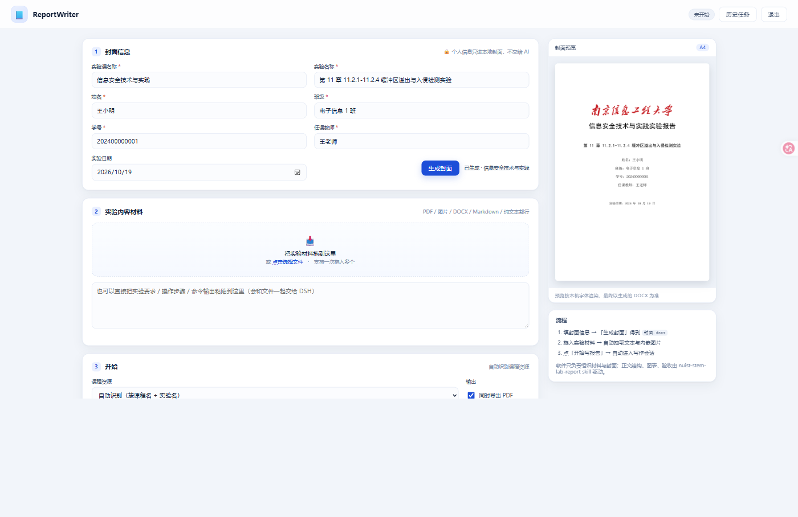

# ReportWriter

**南信大理工科实验报告写作器**

需搭配skill nuist-stem-lab-report使用：

[Yutai233/NUIST-stem-lab-report-skill: 这是一个面向南信大（NUIST）理工科课程实验报告自动化生成Skill，可根据用户提供的材料自动生成实验报告。](https://github.com/Yutai233/NUIST-stem-lab-report-skill)

正文由 DSH 加载 skill **`nuist-stem-lab-report`** 按课程资源写作，软件本身不编造任何实验数据。



封面上那行红色毛体校名，是软件按 `config.json` 里的素材图渲染的，颜色和字体都能在界面上换：

**它能做什么**

- 三步走：填封面 → 拖材料→ 启动程序
- 封面自动生成
- 材料自动入库：DOCX 抽文字 + 抽内嵌图、PDF 抽文字（pypdf）、Markdown 还会**顺着本地图片路径把截图一起收进来**
- 报告由真正的 DSH agent 写：它自己加载 skill、读材料、选课程资源、画图插表，写不动会如实写进 `制作说明.md`
- 结束后软件自己调本机 Word 把 DOCX 转成 PDF，然后亮出「打开报告 / 打开 PDF / 打开目录」
- 历史任务可回放：表单、材料清单、完整日志、产物都在，随时能接着改；不要了可以一键删除（连文件夹一起删）

**环境要求**（缺一不可）

| 依赖                                    | 说明                                           |
| ------------------------------------- | -------------------------------------------- |
| Windows 10/11                         | 用到 Edge 应用窗口、Word COM、PowerShell             |
| [DSH](https://github.com/deepseek-ai) | 提供 `dsh` 命令；软件用 `dsh headless -` 跑写作会话       |
| skill `nuist-stem-lab-report`         | 提供报告结构、课程资源、模板                               |
| Python                                | 用 DSH 自带的 runtime 即可（含 python-docx / Pillow） |
| pypdf                                 | 唯一需要额外装的包，见下面第 0 步                           |
| Microsoft Word（可选）                    | 只有「同时导出 PDF」需要；没装也能交付 DOCX                   |

## 0. 安装

## （这边建议直接让agent帮忙装，部署环境比较麻烦）

### 方式一：一键安装（推荐）

把仓库下载/解压到任意目录（路径里有中文也没问题），双击 **`一键安装.bat`**。它会：

1. 找到可用的 Python 3（优先用 DSH 自带的那个），校验 `python-docx` / `Pillow`
2. 找到 `dsh.cmd`（找不到会让你粘贴路径）和 `nuist-stem-lab-report` skill
3. 把 `pypdf` 装进 `vendor\`（PDF 取字用，失败只影响 PDF 材料）
4. 按检测结果重写 `config.json`（`python` / `dsh` / `skill_root` 都写成可移植形式）
5. **自检**：现场生成一张 A4 封面预览 + 一份封面 DOCX，确认能跑
6. 在桌面建一个 `ReportWriter` 快捷方式

全程不写注册表、不改系统 PATH、不需要管理员权限。有提醒会以 `!` 开头逐条列出（比如没找到 dsh 时，
封面和材料整理照常可用，只是「开始写报告」会失败）。装完可以直接回车启动。

### 方式二：手动

```powershell
git clone <本仓库地址> ReportWriter
cd ReportWriter
# 把 pypdf 装进 vendor（app.py 启动时会挂到 sys.path）
& "$env:USERPROFILE\.dsh\dsh-runtimes\dsh-primary-runtime\dependencies\python\python.exe" -m pip install -r requirements.txt --target vendor
```

然后改 `config.json` 里的 `dsh`（你的 dsh.cmd 路径）与 `skill_root`（skill 目录），两个都支持 `%ENV%`、`~` 和相对路径。

## 1. 启动

双击 **`启动ReportWriter.bat`** 即可。
它会用后台 Python 起一个本机服务，并弹出一个独立的 Edge 应用窗口

- 默认地址：<http://127.0.0.1:8791/>（端口被占用会自动往后顺延）

- 关掉窗口不会停服务；要退干净请点右上角 **退出**，或杀掉 python 进程

命令行启动（调试用）：

```powershell
& "$env:USERPROFILE\.dsh\dsh-runtimes\dsh-primary-runtime\dependencies\python\python.exe" app.py
```

## 2. 三步用法

### ① 封面信息

填 **实验课名称、实验名称、姓名、班级、学号、任课教师**（实验日期默认今天，可改）。
右边实时预览 A4 封面；点 **生成封面**，软件会在 `tasks\<任务>\封面.docx` 里生成真正的封面页，并在封面之后插入**分节符**，正文一定从第 2 页开始。

封面从上到下：**红色毛体「南京信息工程大学」校名**（11 cm 宽图片）→ 报告标题（26pt 黑体加粗）→
实验名称（16pt 黑体）→ 姓名 / 班级 / 学号 / 任课教师（14pt 宋体，**标签左对齐成一列、值带下划线、四行下划线等长且右端对齐**）→ 实验日期（12pt 宋体）。

校名默认是**图片素材** `assets\校名.png`：毛体没有可自由分发的字体文件，所以是从学校官方校名标识里裁出字形、
去掉校徽、染成 `#C41E23` 红再放大 3 倍。封面信息第一行的 **封面校名** 可以现场改三样：

| 控件   | 说明                                                                  |
| ---- | ------------------------------------------------------------------- |
| 校名文字 | 留空＝用 `config.json` 的 `school_text`；填了就换成你的学校（配合下面的字体用）              |
| 字体   | `毛体（图片）`＝用素材图；其余是系统字体（华文行楷 / 楷体 / 仿宋 / 黑体 / 宋体 / 微软雅黑 / 华文新魏），按文字排版 |
| 颜色   | 色板里选；毛体素材会按你选的颜色**重新上色**，文字版直接设字体颜色                                 |

改宽度调 `config.json` 的 `school_logo_cm`，换图直接替换 `assets\校名.png`（透明底 PNG，保持宽高比）；
把 `school_logo` 设成空字符串、字体留「毛体」时会退化为华文行楷 24pt 的文字兜底。

标题规则：课程名以「实验」结尾就补「报告」，否则补「实验报告」
（例：`信息安全技术与实践` → `信息安全技术与实践实验报告`）。

### ② 实验材料

把老师给的东西直接拖进虚线框，或点它选文件：

| 支持                    | 处理方式                          |
| --------------------- | ----------------------------- |
| PDF                   | pypdf 抽文字；页数、无文字层（扫描件）会提示     |
| DOCX                  | python-docx 抽文字 + 抽出内嵌图片      |
| DOC（旧格式）              | 先用本机 Word 另存为 DOCX 再处理        |
| Markdown / TXT / HTML | 抽文字，**并自动跟随文内引用的本地图片**（截图不会丢） |
| PNG / JPG / BMP / GIF | 直接作为截图                        |
| 一段纯文字                 | 粘进下面的文本框，等同材料                 |

每份材料都会：复制进 `材料/`、抽文本到 `材料/抽取文本/`、图片进 `材料/附件图/`、写进 `材料/材料清单.md`。

### ③ 开始

选课程资源（默认「自动识别」，按课程名 + 实验名匹配），点 **🚀 开始写报告**。

「输出文件名」可以留空：留空时由模型自己起名（通常就是 `实验报告.docx`）；填了就用你给的
名字（不用写 `.docx`，路径符 `\ / : * ? " < > |` 会被自动换掉），提示词里会把它写成硬要求，
交付后软件也按这个名字找文件转 PDF。

软件会：

1. 生成 `任务说明.md`（含封面、材料清单绝对路径、课程资源、输出要求、真实性约束）；
2. `dsh headless -` 启动一个全新 DSH 会话，把提示词从 stdin 喂进去，cwd 就是任务目录；
3. 实时把 DSH 的 stdout/stderr 打到页面上的黑色日志框；
4. 结束后扫描 `输出/*.docx`，识别最后一行 `DONE: <路径>`，**再由软件自己用本机 Word 把 DOCX 转成 PDF**
   （勾选了「同时导出 PDF」才转；约 10 秒）；
5. 亮出 **打开报告 / 打开 PDF / 输出目录** 按钮，记 `运行记录.log`，随时可以点 **中止**。

## 3. 目录结构

任务目录放在 **`%LOCALAPPDATA%\ReportWriter\tasks\`**（即 `C:\Users\<你>\AppData\Local\ReportWriter\tasks`），
不放在本工程目录下 —— 因为 DSH 的沙箱需要给工作目录追加 ACL，D: 盘的继承 ACL 缺 `WRITE_DAC`，
会给所有子进程报 `SetNamedSecurityInfoW failed (Win32 5): grantWrite(...)`，导致模型的所有 shell 命令都被拒。

## 4. config.json

| 键                | 说明                                                                       |
| ---------------- | ------------------------------------------------------------------------ |
| `dsh`            | dsh 可执行文件，默认 `D:\dsh\resources\runtime\cli\bin\dsh.cmd`                  |
| `python`         | 打包 Python（python-docx / Pillow / pypdf 装在 `vendor`），默认指向 DSH 自带的 runtime |
| `vendor`         | 额外依赖目录，启动时挂到 `sys.path`（相对路径按本程序目录解析）                                    |
| `skill_root`     | `nuist-stem-lab-report` skill 目录，支持 `~` 与环境变量                            |
| `work_root`      | 任务输出根目录                                                                  |
| `timeout`        | 单次写作最长秒数（默认 2700 = 45 分钟，超时自动 taskkill）                                  |
| `port`           | 首选端口                                                                     |
| `open_browser`   | 启动后是否自动弹 Edge 应用窗口                                                       |
| `school_logo`    | 封面红字校名素材路径，默认 `assets/校名.png`；设空字符串则用文字兜底                                |
| `school_logo_cm` | 校名图片宽度（cm），默认 `11.0`                                                     |
| `school_text`    | 校名默认文字，默认 `南京信息工程大学`（界面「封面校名」留空时用它）                                      |
| `school_font`    | 校名默认字体，默认 `毛体`（＝图片素材）；可填 华文行楷/楷体/仿宋/黑体/宋体/微软雅黑/华文新魏                      |
| `school_color`   | 校名默认颜色，默认 `#C41E23`（界面上的色板会覆盖它）                                          |

## 5. 常见问题

**「图片/PDF 抽不出字」** → 扫描件没有文字层，软件会提示；直接把截图当图片丢进来即可，DSH 能看图。

**「导出 PDF」失败** → 需要本机装 Microsoft Word（软件用 COM 转换，Word 必须在沙箱外的软件进程里跑）。没装也能交付 DOCX。

**「dsh 启动失败 / 秒退」** → 看日志框和 `运行记录.log`；检查 `config.json` 里的 `dsh` 路径，命令行手动跑一次
`& 'D:\dsh\resources\runtime\cli\bin\dsh.cmd' headless -` 验证。

**封面字体不对** → 需要 黑体(simhei)、宋体(simsun)；Windows 一般自带。

**任务太多** → 打开「历史任务」，每行右边的 **删除** 按钮会把任务连同它的整个文件夹（材料 / 封面 / 输出）一起删掉，
删前有一次确认；也可以直接删 `%LOCALAPPDATA%\ReportWriter\tasks\` 里对应的目录。

## 6. 声明

- 这是**个人工具**，不是南京信息工程大学官方项目；`assets/校名.png` 取自学校公开的校名标识，仅为排版还原，
  版权归学校所有。若校方介意请自行替换或把 `config.json` 的 `school_logo` 设为空（会退化为华文行楷文字）。
- `示例/` 里的报告正文由 AI 生成、插图来自课程实验指导书，**仅作演示**；如需公开发布，建议替换成自制截图。
- 生成内容的事实依据全部来自你提供的实验材料；软件**不会**替你编造实验数据，材料不足时它会如实写进 `制作说明.md`。
- 请遵守所在课程的作业与学术诚信规定，仅把 AI 当排版与写作助手。

## 7. 许可

[MIT](LICENSE) © 2026 ReportWriter Contributors

skill `nuist-stem-lab-report` 不在本仓库内；它的版权与使用条款归其作者。
